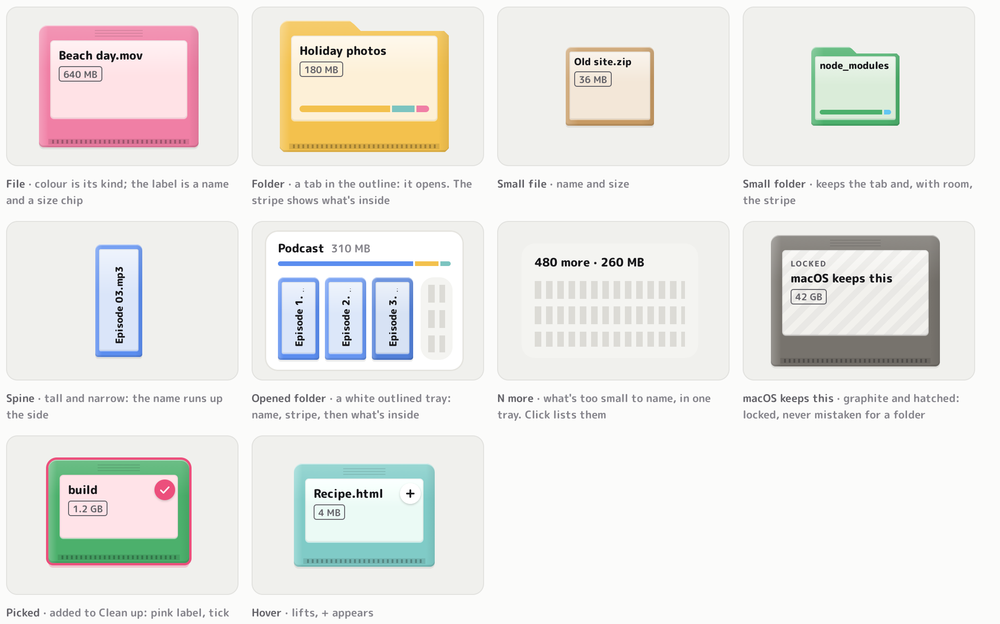

# Rumi

A Mac app that shows what's filling your disk as a shelf of cartridges, and helps you clear it safely.



## What it does

- **Maps your disk.** Home and Applications are drawn to size. Colour is the kind of content, a tab means folder, and the stripe on a folder shows the mix inside.
- **Hides nothing.** The space outside your folders shows as one locked "macOS keeps this" cartridge, broken down into what it is.
- **Shows what changed.** A chip says how much the disk moved since last time; click it to see only what grew, shrank, is new or was removed.
- **Cleans up safely.** Caches, old downloads, duplicates and big forgotten files, each labelled Safe or Check first. Everything goes to the Trash and can be undone.
- **Finds things, from anywhere.** A cartridge in the menu bar, or ⌃⌥Space from any app, opens search over whatever you're doing: type, press ↵, and the file opens. ⌘↵ shows it in Finder. In the app, ⌘F does the same, and the header's kinds filter the map to just videos, PDFs and so on.
- **Opens things.** Photos, videos, web pages and code open inside the app.

Nothing leaves your Mac: no account, no tracking, no network calls.

## Build it

You need an Apple Silicon Mac on macOS 14 or later and the Xcode Command Line Tools (`xcode-select --install`). Xcode itself isn't needed.

```sh
scripts/build.sh            # builds build/Rumi.app
scripts/build.sh --install  # also copies it to /Applications and opens it
```

On first launch Rumi asks for Full Disk Access, so Mail, Photos and the like aren't missing from the map. Closing the window leaves Rumi in the menu bar and frees the window's memory; ⌘Q quits. Right-click the cartridge to have Rumi start at login.

**Signing.** macOS ties Full Disk Access to the app's signature. Set `RUMI_SIGN_ID` to a code-signing identity in your keychain (a self-signed one works) and access survives rebuilds. Without one the build is signed ad hoc and macOS asks again after each build.

## How it's put together

| Folder | What's in it |
|---|---|
| `mac/Sources` | The Swift app: a parallel disk scanner, the saved scan, duplicates, search, the Trash and Undo, and one window holding a web view |
| `web` | The interface: `index.html` (the map and lists), `quick.html` (the menu-bar search panel), `base.js` and `find.js` (shared helpers and search), `app.css` and `styles.css` (the cartridge look), `rumi.js` (the mascot), `design-system.html` (every rule and component) |
| `scripts` | The build, with no Xcode project: plain `swiftc` |

The page talks to the app over a private `rumi://` scheme and a message bridge, with a token that's new every launch. Pages opened in the viewer run sealed off and can't reach either.

## Status

A personal project, built on and for one Mac. It works well there; expect rough edges elsewhere. There's no packaged download yet.

## Licence

MIT. See [LICENSE](LICENSE). The bundled font, M PLUS Rounded 1c, is under the SIL Open Font License (`web/fonts/OFL.txt`).
